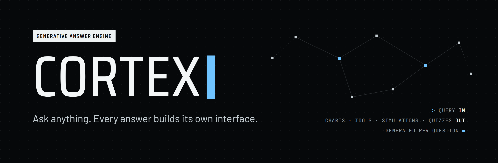
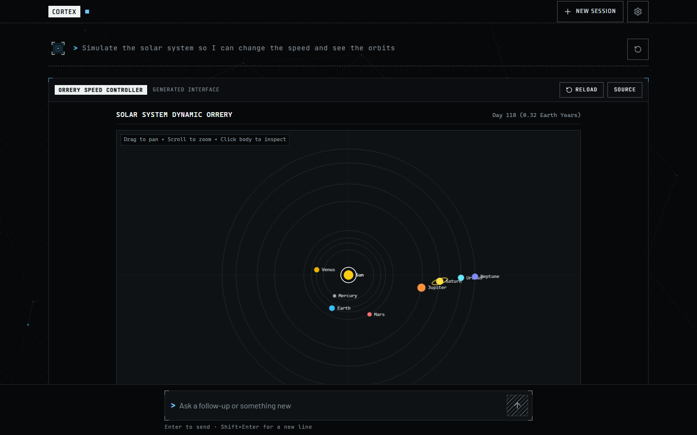
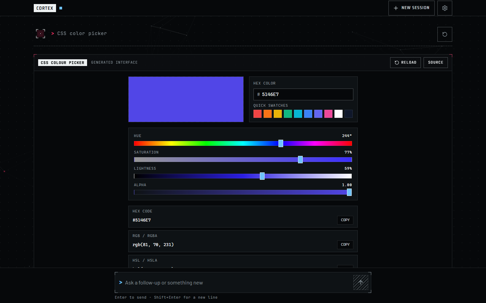
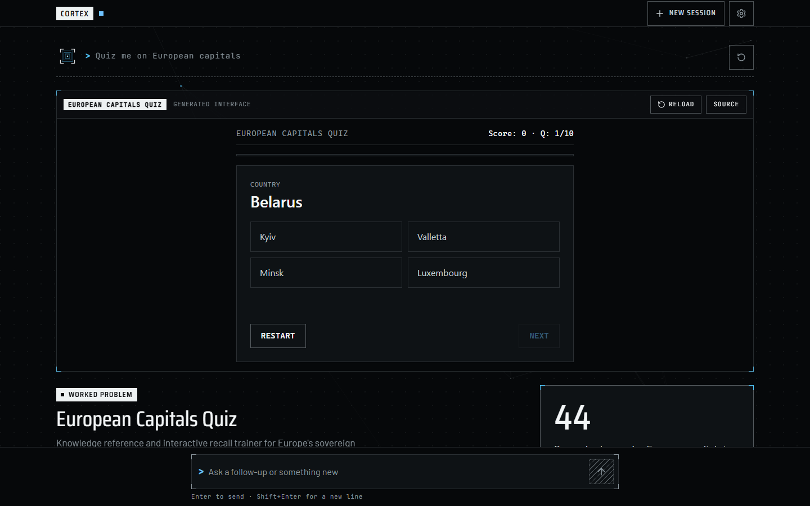
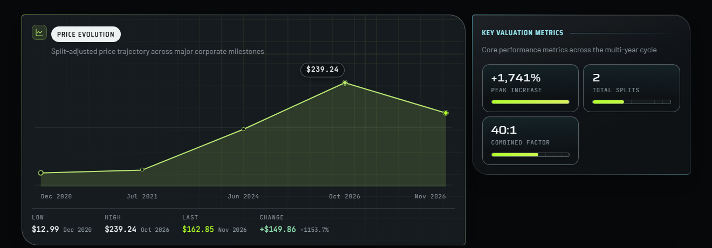
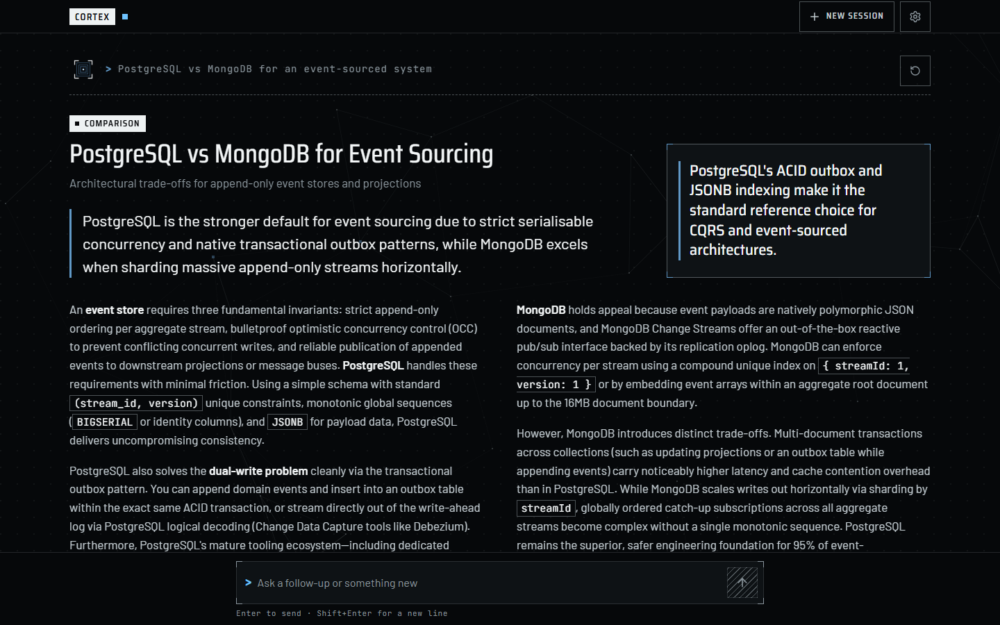
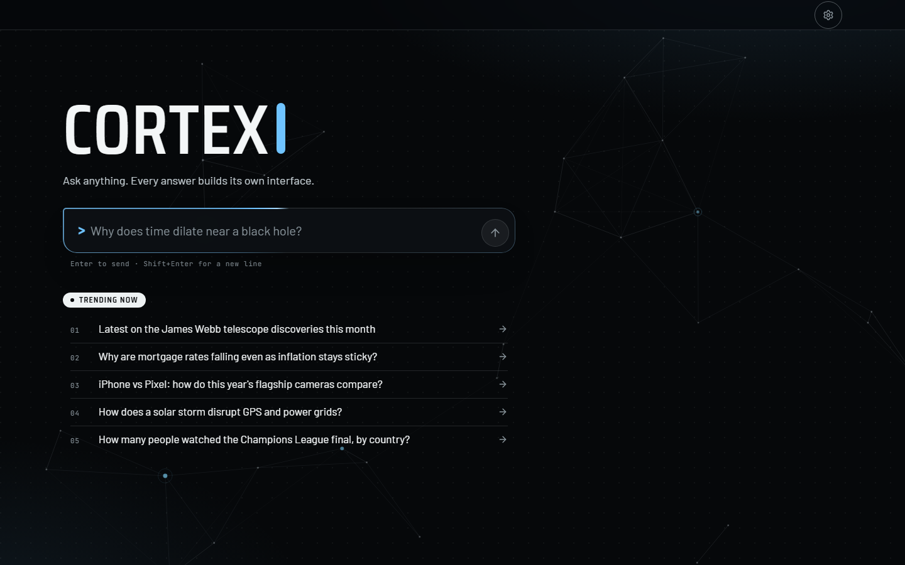

<p align="center">
  
</p>

<p align="center">
  <a href="LICENSE"></a>
  
  
  
</p>

# Cortex

Most AI answers arrive as a wall of text. Cortex answers with an interface.

Ask how a stock has moved and you get a chart with the low, the high and the change worked out. Ask for a
CSS colour picker and you get a working colour picker. Ask it to quiz you on European capitals and it
builds the quiz, keeps score, and hands you the reference notes underneath. Nothing on the screen was
laid out in advance: every answer decides what it should look like, and when no existing component fits,
the model writes a new one for that question and Cortex runs it in a sandbox.

<p align="center">
  
</p>
<p align="center"><sub>"Simulate the solar system so I can change the speed and see the orbits." This orrery did not exist before the question was asked.</sub></p>

## What you can ask for

Every screenshot below is a real answer from a running instance. No mock-ups, no hand-built demos.

<table>
<tr>
<td width="50%"></td>
<td width="50%"></td>
</tr>
<tr>
<td><b>A tool.</b> "CSS color picker" returns sliders, swatches and copyable <code>hex</code>, <code>rgb()</code> and <code>hsl()</code> output.</td>
<td><b>Something to practise.</b> "Quiz me on European capitals" returns ten questions, scoring and a restart.</td>
</tr>
<tr>
<td></td>
<td></td>
</tr>
<tr>
<td><b>Data over time.</b> "How has NVIDIA's stock price evolved since 2020?" becomes a chart, yearly returns and a dated timeline, with sources.</td>
<td><b>A decision.</b> "PostgreSQL vs MongoDB for an event-sourced system" becomes a verdict, both sides argued, and a guide for choosing.</td>
</tr>
</table>

The same goes for a worked physics problem, a recipe, a person, a place, today's news, a binary search you
can step through, a unit converter, a pomodoro timer. If you can describe it, Cortex will try to build the
right surface for it.

## Why it feels different

- **The answer comes first.** One sentence that answers the question, then the detail. The interface is
  there to support it, never to make you hunt for it.
- **It builds while you watch.** A fast router themes the page in about a second, a research pass brings
  back real sources, and the answer assembles piece by piece instead of appearing after a spinner.
- **Two ways to render, picked per question.** Standard content (charts, timelines, comparisons, stats,
  steps, code, formulas and more) maps to a library of native components. Anything else gets a bespoke
  interface written from scratch by the model.
- **Generated code never touches the app.** A generated interface runs in an iframe with
  `sandbox="allow-scripts"` only and a Content Security Policy that blocks requests and external
  resources. It cannot read the page around it, your cookies or your storage.
- **Grounded, with receipts.** Factual answers are researched with Google Search grounding and list
  their sources. Cortex does not ship a market-data feed: figures come from what the research finds, and
  the answer says so when a number is approximate.
- **One look, everywhere.** A terminal-style HUD: near-black, hairlines, square frames, a single signal
  colour per answer. It holds at 390, 768 and 1440 px, honours reduced motion, and speaks English and
  Spanish.

<p align="center">
  
</p>

## Run it locally

You need [Node.js](https://nodejs.org) 24 or newer and a free Gemini API key from
[Google AI Studio](https://aistudio.google.com).

```bash
git clone https://github.com/nikolmedo/cortex.git
cd cortex
npm install
```

Create a file named `.env` in the project root:

```env
GEMINI_API_KEY=your-key-here
PORT=3001
```

Start it:

```bash
npm run dev
```

The API (port 3001) and the web client open in two terminal windows. Go to
[http://localhost:5173](http://localhost:5173) and ask something.

If you would rather keep everything in one terminal, use `npm run dev:concurrent`, or run
`npm run dev:server` and `npm run dev:client` yourself.

### Try it without an API key

Cortex ships with recorded answers that replay through the same streaming path, so you can see the whole
experience offline and for free:

```bash
NODE_ENV=development CORTEX_FIXTURES=1 npm run dev:server
```

```bash
npm run dev:client
```

On Windows PowerShell, set the variables first: `$env:NODE_ENV='development'; $env:CORTEX_FIXTURES='1'; npm run dev:server`.
Any question you type is matched to the closest recorded answer in `server/fixtures/`.

### Configuration

| Variable | Default | Purpose |
|---|---|---|
| `GEMINI_API_KEY` | none | Required unless `CORTEX_FIXTURES=1` |
| `GEMINI_MODEL` | `gemini-3.8-flash` | Writes the answer and the generated interfaces |
| `GEMINI_PREFACE_MODEL` | `gemini-3.5-flash-lite` | Fast router that themes the page and decides the format |
| `GEMINI_RESEARCH_MODEL` | `gemini-3.5-flash-lite` | Grounded research with Google Search |
| `GEMINI_TIMEOUT_MS` | `75000` | Cap for the answer call |
| `CORTEX_PREFACE_TIMEOUT_MS` | `8000` | The router never blocks the answer |
| `CORTEX_RESEARCH_TIMEOUT_MS` | `15000` | On timeout the answer is written without sources |
| `CORTEX_APPLET_TIMEOUT_MS` | `45000` | Cap for building a generated interface |
| `CORTEX_FIXTURES` | off | `1` replays recorded answers, no paid calls. Needs `NODE_ENV=development` |
| `CORTEX_FIXTURES_DIR` | `server/fixtures` | Where the replay reads from |
| `CORTEX_CAPTURE_DIR` | off | Saves every real answer as a fixture. Needs `NODE_ENV=development` |
| `PORT` | `3001` | API port |

The key stays on the server. A `VITE_`-prefixed key is never read and never reaches the browser.

## How it works

```
question
   ├─ router        fast model: intent, layout, palette, and whether a bespoke interface is needed
   ├─ research      grounded search: notes and sources
   ├─ answer        structured Scene (JSON), streamed and validated field by field
   └─ interface     optional: self-contained HTML written for this question, sandboxed
```

The model does not send markup for the answer itself. It returns a **Scene**: the answer plus a
presentation spec (intent, layout, mood, density, palette, module kinds), validated by a strict schema on
the server and checked again in the browser. A registry of React components renders it. That is why an
answer can look like a dossier, a worked solution or a dashboard and still be safe to render.

When a question needs something the registry cannot express, the router asks for a generated interface.
A separate model call writes one self-contained HTML fragment, the server checks it, and the client mounts
it in a sandboxed frame themed to match the page. It streams on its own event, so the written answer never
waits for it, and if it fails the answer is still there.

Everything travels over one server-sent event stream: `preface`, `research`, `partial` scenes, the final
`scene`, the optional `applet`, then `done`.

## Stack

| Layer | Choice |
|---|---|
| Frontend | React 19, Vite 8, TypeScript 6 (strict), CSS Modules with design tokens, no CSS framework |
| Backend | Node.js, Express 5, server-sent events over POST |
| AI runtime | Genkit with `@genkit-ai/google-genai` |
| Models | `gemini-3.8-flash` for answers and interfaces, `gemini-3.5-flash-lite` for routing and research |
| Tests | Vitest, a contract drift check between server and client schemas, a Playwright screenshot pass |

## Development

```bash
npm test                           # unit tests
npm run typecheck                  # client and server
npx tsx scripts/drift-check.mts    # the server and client Scene contracts must match
npm run build                      # server (tsc) and client (vite)
npm run shots                      # screenshots and an overflow audit at 390, 768 and 1440
```

Architecture, the design system, the generation pipeline and step-by-step recipes live in
[`docs/agents/`](docs/agents), written so that an AI coding agent (or a new contributor) can make a
correct change without exploring the whole tree. [`CLAUDE.md`](CLAUDE.md) is the index.

## Contributing

Issues and pull requests are welcome. The fastest ways to help:

- Add a module kind, so more answers render natively ([recipe](docs/agents/recipes.md)).
- Record a fixture for a question that produced something worth keeping.
- Report an answer that chose the wrong shape for its question.

## License

[GPL-3.0](LICENSE)
